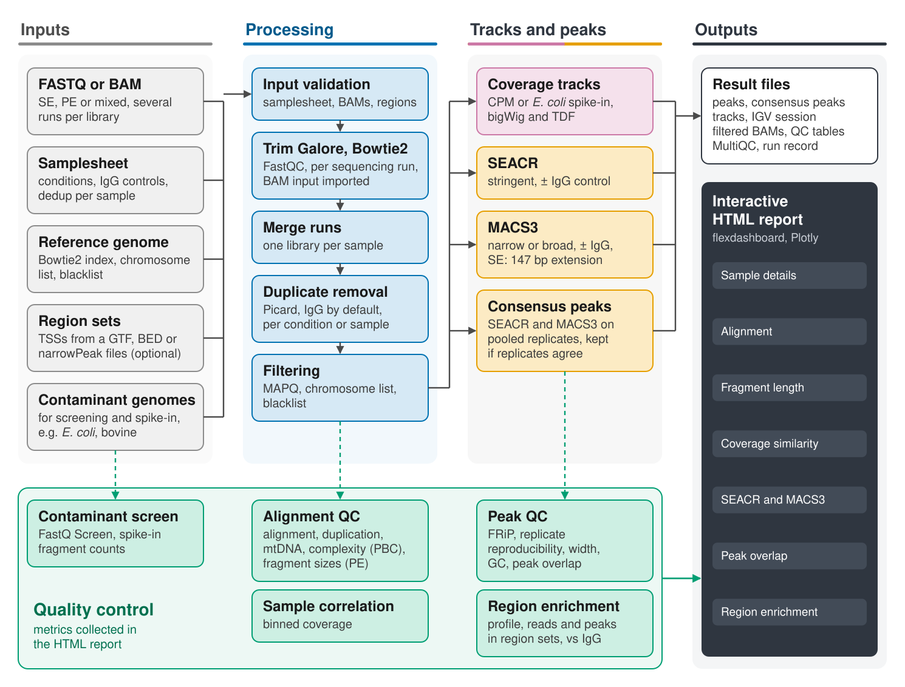

# CAWS: CUT&Tag Analysis Workflow System

[](https://github.com/ratan-lab/CAWS/actions/workflows/test.yml)
[](https://caws.readthedocs.io/)
[](https://opensource.org/licenses/MIT)
[](https://snakemake.readthedocs.io)

**CAWS** is a Snakemake pipeline for CUT&Tag (Cleavage Under Targets and Tagmentation) sequencing data. CUT&Tag maps protein–DNA interactions and histone modifications in situ, with lower background and fewer cells than ChIP-seq (Kaya-Okur et al., 2019). CAWS takes reads or alignments to peaks, coverage tracks, quality control metrics and an interactive HTML report.

**Documentation: [caws.readthedocs.io](https://caws.readthedocs.io/)**



## Highlights

- **Flexible input.** FASTQ or BAM, single-end, paired-end or mixed, with several sequencing runs per library merged before duplicate removal.
- **Two peak callers.** SEACR and MACS3 (narrow or broad), with or without IgG controls, plus ENCODE-style consensus peaks per condition.
- **CUT&Tag-aware choices.** Duplicates are removed from IgG controls by default and can be set per condition or sample. Coverage tracks are normalized to CPM or to *E. coli* carry-over spike-in.
- **Quality control.** Alignment, duplication, library complexity (NRF, PBC), mtDNA, contamination, fragment sizes, FRiP, replicate reproducibility, and enrichment over TSSs or your own region sets relative to IgG.
- **Reports.** An interactive HTML report, a MultiQC report, and an IGV session with all tracks and peaks.
- **Reproducible.** Per-rule conda environments with pinned versions, and a record of the configuration and software versions of every run.

## Installation

CAWS needs Snakemake ≥ 9, conda ≥ 24.7.1 and Linux (x86-64). All other tools are installed automatically into per-rule conda environments.

```bash
git clone https://github.com/ratan-lab/CAWS.git
cd CAWS
conda env create -f envs/snakemake-runner.yaml
conda activate caws-snakemake
```

For cluster use, set your SLURM account and partition in `profiles/slurm/config.yaml`. See [Installation](https://caws.readthedocs.io/en/latest/installation/).

## Quick start

1. Write a samplesheet (`sampleID`, `condition`, `group`, `read1`, `read2`). Samples with condition `Control` are IgG controls, and `group` pairs samples with their control.
   ```tsv
   sampleID	condition	group	read1	read2
   K27me3_rep1	H3K27me3	rep1	/data/K27me3_rep1_R1.fastq.gz	/data/K27me3_rep1_R2.fastq.gz
   IgG_rep1	Control	rep1	/data/IgG_rep1_R1.fastq.gz	/data/IgG_rep1_R2.fastq.gz
   ```
2. Copy `config.json` and fill in the samplesheet, reference files and output directory. See [Configuration](https://caws.readthedocs.io/en/latest/configuration/).
3. Run CAWS locally or on SLURM:
   ```bash
   snakemake --cores 8 --use-conda --configfile config.json
   snakemake --profile profiles/slurm --configfile config.json
   ```
4. Open `<outdir>/reports/cutntag_analysis_report.html`.

The [quick start](https://caws.readthedocs.io/en/latest/quickstart/) and the [tutorial](https://caws.readthedocs.io/en/latest/tutorial/) with public H3K4me3 data describe each step.

## Testing

A small test dataset (H3K27me3 and IgG from K562 cells, subset to 4 Mb of chr22) is included. GitHub Actions runs it on pushes to `main` and on pull requests. After the installation steps above:

```bash
conda create -n caws-setup -c conda-forge -c bioconda bowtie2=2.5.1 samtools
conda run -n caws-setup bash .test/setup.sh
snakemake -s workflow/Snakefile --configfile .test/run/config.json --use-conda --cores 4
bash .test/check_outputs.sh
```

## Getting help and contributing

- **Questions and bug reports**: open an issue at https://github.com/ratan-lab/CAWS/issues. Please include your `config.json`, the samplesheet (paths can be redacted), the failing rule's log from `logs/`, and the Snakemake and conda versions.
- **Contributing**: see [CONTRIBUTING.md](CONTRIBUTING.md).

## Use of AI assistance

Since January 2026, development of CAWS has been assisted by generative AI tools, primarily Claude Code (Anthropic). AI assistance has been used for writing and modifying workflow code, scripts, and documentation. The architecture of the pipeline, the choice of tools and methods, and the overall design of the system are the result of decisions made by the human developers. All AI-assisted changes are reviewed by a human developer before being committed, and are checked by running the workflow (including dry runs and tests on small datasets) before release.

## License

CAWS is licensed under the MIT License. See [LICENSE](LICENSE).

## Acknowledgements

We thank the developers of all tools integrated into CAWS and the wider bioinformatics community for providing the foundational software that makes this workflow possible.
