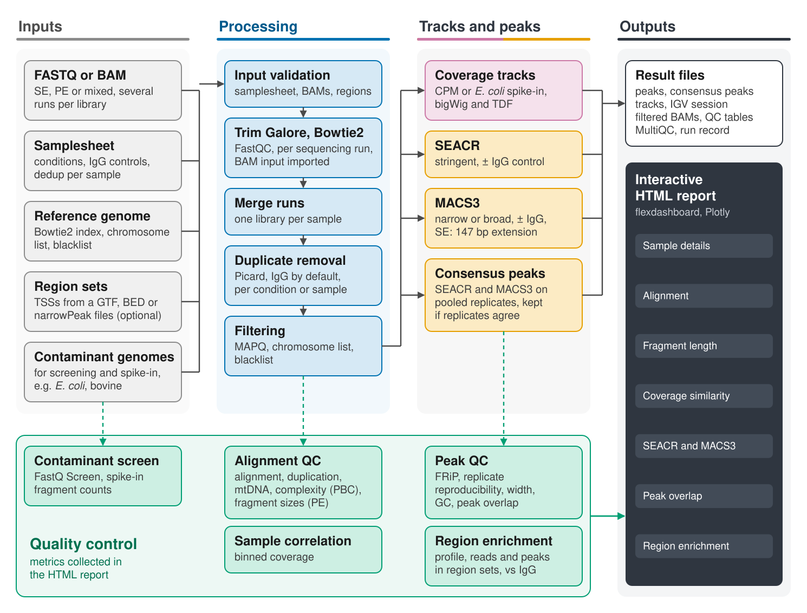

# CAWS: CUT&Tag Analysis Workflow System

**CAWS (CUT&Tag Analysis Workflow System)** is a comprehensive Snakemake pipeline for analyzing CUT&Tag (Cleavage Under Targets and Tagmentation) sequencing data. CUT&Tag is an epigenomic profiling method that maps protein–DNA interactions and histone modifications in situ, with lower background and fewer cells than ChIP-seq (Kaya-Okur et al., 2019).  

## Why use CAWS?

- **CUT&Tag Optimized** – Purpose-built for CUT&Tag data with specialized QC and peak-calling strategies
- **Flexible Input** – Supports single-end, paired-end, and mixed datasets in the same analysis
- **Comprehensive Analysis** – End-to-end workflow from raw reads to interactive visualizations
- **Dual Peak Calling** – Generates peak calls using both SEACR and MACS3 for robust peak detection
- **Interactive Reports** – HTML dashboards with Plotly-based visualizations
- **Reproducible** – Per-rule conda environments with pinned tool and R package versions (`workflow/envs/`)

## Target audience

CAWS is designed for:  
- Bioinformaticians analyzing CUT&Tag datasets  
- Researchers studying chromatin biology or epigenomics  
- Laboratories seeking standardized workflows  
- Users requiring comprehensive QC and visualization  

## Features

### Data Input Flexibility
- **Single-End & Paired-End Support** – Process SE, PE, or mixed datasets seamlessly
- **Automatic Detection** – Pipeline automatically identifies sequencing type from samplesheet
- **SE/PE Compatibility Validation** – Ensures experimental samples and controls have matching sequencing types
- **Optimized Processing** – Separate optimized workflows for SE and PE data with appropriate biological handling

- **BAM Input and Multiple Runs** – Aligned BAM files can be used instead of FASTQ; several sequencing runs of a library are merged before duplicate removal
- **Input Validation** – Checks the samplesheet (files exist, consistent rows per sample, one control per group, matching read types), BAM references, region files and the contaminant and dedup configuration at startup; checks that GTF chromosome names match the reference when extracting TSSs

### Core Pipeline
- Adapter trimming (**Trim Galore**) and read QC (**FastQC**, on trimmed reads when trimming is enabled)
- Alignment (**Bowtie2**; paired-end in concordant-pair mode)
- Duplicate removal (**Picard**) from IgG controls by default, configurable for all samples or per sample; duplication rate and estimated library size (paired-end) are reported for every sample
- Filtering by mapping quality, chromosome list and blacklist
- Peak calling with both **SEACR** (stringent) and **MACS3** (narrow or broad peaks); IgG control used by both when enabled. Paired-end samples use actual fragments (`BAMPE`); single-end samples use a fixed 147 bp extension
- Consensus peaks per condition (ENCODE-style): peaks are called on the pooled replicates of each condition and kept if they overlap peaks in at least `consensus_min_replicates` replicates by at least 50% of either peak. Pooling uses fragments, with single-end reads extended to 147 bp, so conditions can mix single-end and paired-end replicates; IgG controls of the condition's groups are pooled the same way
- Contamination screening (**FastQ Screen**: *E. coli*, bovine, or any configured genome) and mitochondrial read fraction
- Coverage tracks normalized to counts per million (CPM, default) or to *E. coli* carry-over spike-in fragments (optional), with spike-in fragments counted for every sample when a spike-in genome is set

### QC Metrics and Visualization
- Fragment size distributions (paired-end)
- Coverage correlation between samples (Pearson, log2 counts in 500 bp bins; 50,000 bins sampled)
- FRiP, peak reproducibility between replicates, and pairwise peak overlap between samples (shared / total merged peak intervals)
- Peak width distributions (narrow/broad categories) and median peak GC content
- Enrichment over TSSs and user-supplied region sets (e.g. PQS, ATAC peaks): signal profile, reads in regions and peak overlap vs. shuffled peaks, each relative to the matched IgG
- Library complexity (ENCODE NRF, PBC1, PBC2) with PCR bottleneck grading
- Signal heatmaps around SEACR peak summits (**deepTools**)
- Normalized coverage tracks from the filtered alignments as TDF (IGV) and bigWig (fragment coverage for paired-end, read coverage for single-end)
- Interactive HTML dashboard (**flexdashboard**/**Plotly**) with exportable tables
- **MultiQC** report of FastQC, Trim Galore, Bowtie2, Picard and FastQ Screen results
- IGV session file that loads all coverage tracks and peak sets
- Record of the configuration, samplesheet and pinned software versions used for the run

## Key dependencies

- **Snakemake** — Workflow management  
- **Bowtie2** — Alignment  
- **SEACR** — CUT&RUN/CUT&Tag peak calling  
- **MACS3** — Model-based ChIP-seq analysis  
- **FastQC**, **Trim Galore**, **Picard**, **FastQ Screen**, **samtools**, **bedtools**, **deepTools**, **igvtools**, **bedGraphToBigWig** (UCSC)  
- **R packages** — `tidyverse`, `GenomicRanges`, `Rsamtools`, `plotly`, `flexdashboard`, `DT`

## Getting help

- **Questions and bug reports**: open an issue at https://github.com/ratan-lab/CAWS/issues. Please include your `config.json`, the samplesheet (paths can be redacted), the failing rule's log from `logs/`, and the Snakemake and conda versions.
- **Contributing**: see [CONTRIBUTING.md](https://github.com/ratan-lab/CAWS/blob/main/CONTRIBUTING.md).

## Use of AI assistance

Since January 2026, development of CAWS has been assisted by generative AI tools, primarily Claude Code (Anthropic). AI assistance has been used for writing and modifying workflow code, scripts, and documentation. The architecture of the pipeline, the choice of tools and methods, and the overall design of the system are the result of decisions made by the human developers. All AI-assisted changes are reviewed by a human developer before being committed, and are checked by running the workflow (including dry runs and tests on small datasets) before release.

## License

This project is licensed under the **MIT License**.  
See the [LICENSE](https://github.com/ratan-lab/CAWS/blob/main/LICENSE) file for details.  

## Acknowledgements

We thank the developers of all tools integrated into CAWS and the wider bioinformatics community for providing the foundational software that makes this workflow possible.  
